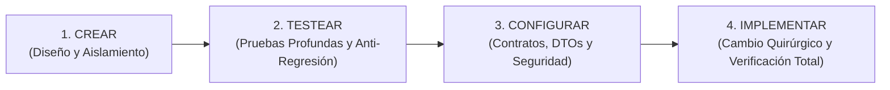

# 🛡️ Non-Breaking Delivery Protocol (Crear ➔ Testear ➔ Configurar ➔ Implementar)

Este protocolo es de **lectura y cumplimiento obligatorio** antes de realizar cualquier cambio, adición o corrección en el software. Su objetivo primordial es **garantizar cero regresiones** (nunca romper código, tests ni flujos existentes).

---

## 🔄 El Ciclo de 4 Fases Obligatorias



---

### 1️⃣ Fase 1: CREAR (Design & Isolation)
- **Análisis de Impacto:** Identificar todos los componentes, servicios y controladores que se relacionan con la funcionalidad o corrección.
- **Aislamiento:** Diseñar el cambio en la capa más estrecha responsable sin introducir efectos colaterales en entidades compartidas.
- **Defensa en Profundidad:** Verificar contratos de seguridad (Anti-IDOR, roles ADMIN/HOST/USER, validación de entrada).

### 2️⃣ Fase 2: TESTEAR PROFUNDAMENTE (Deep Testing & Anti-Breakage Proof)
- **Línea Base:** Conocer el estado actual de las pruebas antes de modificar código (`./mvnw test` y `npm test`).
- **Pruebas de Caso Límite:** Diseñar pruebas automatizadas que cubran:
  - Camino feliz (datos válidos).
  - Camino de fallo / rechazo (datos inválidos, estados terminales, intentos no autorizados).
  - Casos de frontera y concurrencia.
- **Regla de Oro Anti-Regresión:** Ningún test existente puede fallar. Si un cambio modifica intencionalmente un comportamiento previo, debe existir justificación técnica documentada.

### 3️⃣ Fase 3: CONFIGURAR (Wire, DTOs & Security)
- **DTOs y Contratos:** Nunca exponer entidades directamente; configurar DTOs con anotaciones de validación Jakarta (`@NotBlank`, `@Min`, `@Max`).
- **Seguridad y Permisos:** Ajustar `SecurityConfig`, autorizaciones por rol y filtros de entrada antes de escribir la lógica interna.
- **Infraestructura y CI:** Asegurar que los scripts de build y CI (`ci.yml`, `package.json`) tengan los pasos requeridos para ejecutar la validación continua.

### 4️⃣ Fase 4: IMPLEMENTAR (Surgical Execution & Final Gate)
- **Modificación Quirúrgica:** Escribir el código estrictamente necesario, manteniendo intactos los comentarios, docstrings y lógica circundante.
- **Verificación Completa de Cierre:**
  ```bash
  # 1. Backend: suite completa en verde
  cd backend-java && ./mvnw test
  # 2. Frontend: compilación de producción limpia
  cd frontend-angular && npm run build
  # 3. Frontend: pruebas unitarias pasando
  cd frontend-angular && npm test -- --watch=false
  ```
- **Documentación:** Actualizar la bitácora (`QA_REPORTE.md`), README o diagramas si el cambio impacta la arquitectura o el flujo lógico.
