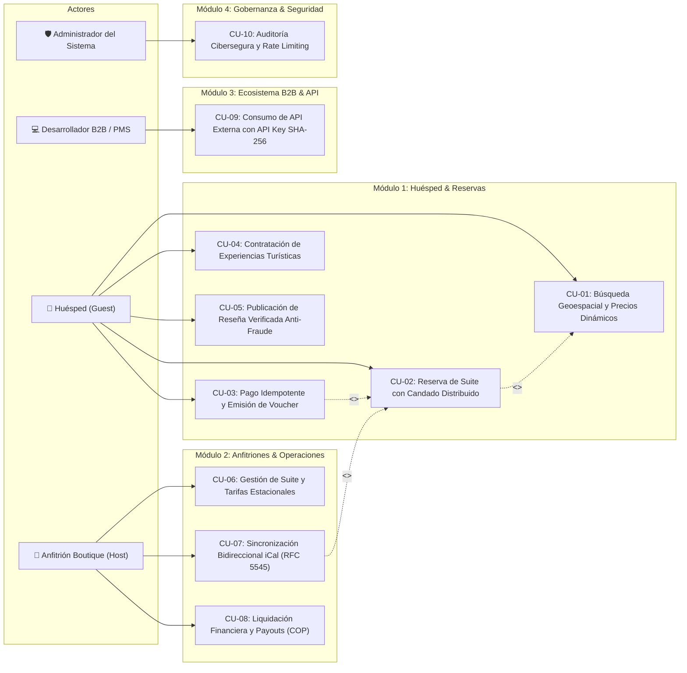

# 🏛️ ESPECIFICACIÓN FORMAL DE CASOS DE USO: PROYECTO PALACIO DEL MAR
**Ecosistema:** Plataforma Boutique de Hospedaje & Marketplace Hotelero de Lujo (Cartagena de Indias, Colombia)  
**Estándar de Documentación:** RUP / Cockburn / IEEE 830 Ampliado  
**Autores & Diseñadores de Arquitectura:** Darío (Gatbat) & Abigail 🖤🐾  
**Fecha:** Noviembre 2026 · Versión 2.0 Definitiva  
**Stack de Referencia:** Java 21 LTS · Spring Boot 3.3+ · Angular 22 · MongoDB 7 · Redis 8 · Nginx  

---

## 🗺️ 1. DIAGRAMA GLOBAL DE CASOS DE USO (UML)

---

## 📋 2. ESPECIFICACIÓN DETALLADA DE CASOS DE USO

---

### 🔹 CU-01: Búsqueda Geoespacial y Filtrado de Suites con Precios Dinámicos

* **ID:** `CU-01`
* **Nombre:** Búsqueda Geoespacial y Cálculo de Tarifas Dinámicas en Tiempo Real.
* **Prioridad:** Alta (Crítica para Conversión).
* **Actor Principal:** Huésped (*Guest*).
* **Actores Secundarios:** Motor de Búsqueda Geoespacial (`GeoSearchService`), Motor de Precios (`DynamicPricingService`), Caché L1/L2 Redis.
* **Precondiciones:**
  1. Existen suites registradas y activas en la base de datos MongoDB con coordenadas geoespaciales válidas (Cartagena de Indias: Bocagrande, Castillogrande, Getsemaní, etc.).
  2. Los índices geoespaciales 2dsphere están construidos en MongoDB y cargados en Redis GEO.
* **Postcondiciones de Éxito:**
  1. Se despliega al usuario un listado reactivo de suites disponibles dentro del radio geográfico solicitado.
  2. El precio por noche reflejado está calculado dinámicamente con precisión `BigDecimal` considerando la demanda estacional y la tasa de ocupación actual.
  3. Se incrementa el contador de visualizaciones en Redis Sorted Sets (`SocialProofService`) para reflejar espectadores activos.
* **Disparador (*Trigger*):** El huésped ingresa destino/playa, fechas de estancia y número de ocupantes en el buscador principal de Angular 22.

#### 🌊 Flujo Principal (Happy Path)
| Paso | Acción del Actor | Respuesta del Sistema |
| :--- | :--- | :--- |
| **1** | El Huésped ingresa criterios de búsqueda (e.g., *Playa de Bocagrande*, check-in, check-out, 2 adultos) y hace clic en "Explorar Suites". | El frontend Angular valida el rango de fechas (check-out posterior a check-in) y despacha una petición `GET /api/v1/suites/search` con parámetros geoespaciales. |
| **2** | - | `GeoSearchService` ejecuta la fórmula de Haversine esférica o consulta Redis GEO para acotar suites en el radio indicado ($\le 5\text{ km}$). |
| **3** | - | El sistema verifica en Redis y MongoDB qué suites no presentan solapamiento de fechas con reservas confirmadas o bloqueos iCal. |
| **4** | - | `DynamicPricingService` evalúa la ocupación del sector y ajusta la tarifa base aplicando factores de demanda y temporadas altas/festivos en Colombia (COP). |
| **5** | - | `SocialProofService` registra un zadd en Redis con la marca de tiempo de la visualización y retorna el número de personas consultando esa misma suite en los últimos 3 minutos. |
| **6** | - | El sistema retorna el payload DTO enriquecido (datos de suite, fotos CDN, precio liquidado y badge de demanda). Angular renderiza las tarjetas con animaciones suaves. |

#### 🔀 Flujos Alternativos
* **1a. Búsqueda sin geolocalización explícita:** Si el huésped busca por nombre de propiedad o amenidad (*"Jacuzzi privado"*, *"Vista al mar"*), el sistema omite el filtro de Haversine y aplica índices de texto B-Tree sobre MongoDB.
* **4a. Tarifa Base Fija:** Si el anfitrión configuró tarifa fija inmune a la demanda, el motor omite el multiplicador dinámico y conserva el precio base pactado.

#### ⚠️ Flujos de Excepción
* **E1. Rango de fechas no disponible:** Si no hay suites libres para las fechas elegidas, el sistema retorna HTTP 200 con lista vacía y sugiere proactivamente los 3 fines de semana adyacentes con disponibilidad.
* **E2. Degradación de Redis:** Si Redis no responde en 500 ms, el sistema aplica *Circuit Breaker*, consulta directamente MongoDB y desactiva temporalmente el badge de prueba social sin interrumpir la búsqueda.

---

### 🔹 CU-02: Reserva de Suite con Prevención de Overbooking y Candado Distribuido

* **ID:** `CU-02`
* **Nombre:** Solicitud de Reserva con Candados Distribuidos contra Sobreventa (*Zero-Overbooking Guarantee*).
* **Prioridad:** Misión Crítica.
* **Actor Principal:** Huésped Autenticado.
* **Actores Secundarios:** Servicio de Candados (`RedisLockService`), Repositorio de Reservas (`BookingRepository`).
* **Precondiciones:**
  1. El Huésped cuenta con una sesión JWT válida y verificada.
  2. La suite seleccionada se encuentra visible y disponible para el rango de fechas.
* **Postcondiciones de Éxito:**
  1. Se genera una reserva en estado `PENDING_PAYMENT` con un temporizador de expiración de 15 minutos.
  2. Las fechas quedan temporalmente bloqueadas para cualquier otro usuario o plataforma externa.
  3. Se libera el candado distribuido de Redis de forma atómica.
* **Disparador:** El huésped pulsa "Confirmar y Proceder al Pago" en el Stepper de Reserva.

#### 🌊 Flujo Principal (Happy Path)
| Paso | Acción del Actor | Respuesta del Sistema |
| :--- | :--- | :--- |
| **1** | El Huésped completa el flujo de 4 pasos (Fechas $\rightarrow$ Huéspedes $\rightarrow$ Servicios Adicionales $\rightarrow$ Resumen) y solicita la reserva. | Angular envía `POST /api/v1/bookings` con la cabecera `Idempotency-Key: UUID-v4` y el cuerpo `BookingRequestDTO`. |
| **2** | - | `RedisLockService` solicita un candado atómico para la clave `lock:suite:{suiteId}:{checkIn}_{checkOut}` con un TTL de 10 segundos. |
| **3** | - | Con el candado en mano, `BookingService` consulta MongoDB para comprobar que ninguna reserva confirmada o pendiente vigente colisione con el intervalo. |
| **4** | - | El sistema calcula el desglose financiero exacto con `BigDecimal` (Tarifa por noches + IVA 19% + Tarifa de limpieza + Comisión de plataforma en COP). |
| **5** | - | Se persiste el documento `Booking` en estado `PENDING_PAYMENT` con vencimiento a 15 minutos. |
| **6** | - | El sistema ejecuta el script Lua atómico para liberar el candado en Redis verificando la coincidencia del token de arrendamiento. |
| **7** | - | Se retorna la reserva creada junto con el token de pasarela de pago al cliente Angular. |

#### ⚠️ Flujos de Excepción
* **E1. Colisión por concurrencia (Condición de carrera / Overbooking interceptado):** Si otro usuario intenta reservar las mismas fechas en el mismo milisegundo:
  1. El segundo hilo no logra adquirir el candado de Redis en el timeout de espera (2 segundos).
  2. El sistema rechaza la petición arrojando `SuiteUnavailableException` (HTTP 409 Conflict).
  3. El frontend muestra: *"Lo sentimos, otro huésped acaba de iniciar el proceso de reserva para estas fechas. Por favor, selecciona otra opción."*
* **E2. Caída del servidor durante la reserva (Resiliencia ante Deadlocks):** Si la JVM colapsa antes de liberar el candado, Redis expira automáticamente el TTL de 10 segundos, evitando bloqueos permanentes.

---

### 🔹 CU-03: Procesamiento Seguro de Pago con Idempotencia y Emisión de Voucher

* **ID:** `CU-03`
* **Nombre:** Liquidación Transaccional de Pago con Blindaje contra Doble Cobro y Generación de Voucher Criptográfico.
* **Prioridad:** Misión Crítica.
* **Actor Principal:** Huésped.
* **Actores Secundarios:** Pasarela de Pagos (`PaymentGateway`), Servicio de Idempotencia (`IdempotencyService`), Despachador de Eventos (`WebhookDispatcher`).
* **Precondiciones:**
  1. Existe una reserva en estado `PENDING_PAYMENT` cuyo tiempo de retención no ha expirado (< 15 min).
  2. La cabecera `Idempotency-Key` viaja en la petición HTTP.
* **Postcondiciones de Éxito:**
  1. La pasarela autoriza la transacción.
  2. La reserva pasa a estado `CONFIRMED`.
  3. Se genera un código QR criptográfico firmado y un voucher digital en PDF descargable.
  4. Se emite un evento asíncrono para notificar al anfitrión y emitir el correo de confirmación.
* **Disparador:** El huésped introduce los datos de su tarjeta/PSE y confirma el pago.

#### 🌊 Flujo Principal (Happy Path)
| Paso | Acción del Actor | Respuesta del Sistema |
| :--- | :--- | :--- |
| **1** | El Huésped ingresa datos de tarjeta o selecciona débito bancario PSE y presiona "Pagar Ahora". | El cliente web despacha `POST /api/v1/payments/process` adjuntando la clave de idempotencia y el ID de reserva. |
| **2** | - | `IdempotencyService` comprueba en Redis si esa `Idempotency-Key` ya fue procesada o está en curso. Al ser nueva, la registra con estado `PROCESSING`. |
| **3** | - | `PaymentService` delega la invocación segura a la pasarela bancaria mediante canal cifrado TLS 1.3. |
| **4** | - | La pasarela responde con código de autorización exitoso (`AUTH_SUCCESS_200`). |
| **5** | - | `BookingService` actualiza el estado de la reserva a `CONFIRMED`, registra la transacción contable con desglose en COP y genera un código de reserva único de 8 caracteres alfanuméricos. |
| **6** | - | Se genera el hash criptográfico del comprobante y se almacena la respuesta en la clave de idempotencia de Redis (TTL 24 horas). |
| **7** | - | El sistema despacha un mensaje al Redis Stream de notificaciones (`notifications:stream`) para el envío de correo y actualización en tiempo real. |
| **8** | - | El frontend recibe el voucher formal con botón de descarga en PDF y mapa de acceso interactivo. |

#### ⚠️ Flujos de Excepción
* **E1. Doble clic compulsivo o reintento de red:** Si el usuario presiona dos veces el botón de pago:
  1. La segunda petición llega con la misma `Idempotency-Key`.
  2. Redis detecta que la clave ya está en estado `PROCESSING` o `COMPLETED`.
  3. El sistema no invoca a la pasarela bancaria por segunda vez y retorna inmediatamente el resultado de la primera transacción, **impidiendo el doble cobro**.
* **E2. Fondos insuficientes / Transacción rechazada:** La pasarela retorna error; la reserva permanece en `PENDING_PAYMENT` y el usuario dispone del tiempo restante de los 15 minutos para intentar con otro medio de pago.

---

### 🔹 CU-07: Sincronización Bidireccional iCal (RFC 5545) con Airbnb y Booking.com

* **ID:** `CU-07`
* **Nombre:** Sincronización Automática de Disponibilidad Multiplataforma mediante Protocolo iCalendar.
* **Prioridad:** Alta.
* **Actor Principal:** Anfitrión Boutique (*Host*) / Worker Programado (`@Scheduled`).
* **Actores Secundarios:** Plataformas Externas (Airbnb, Booking.com, VRBO), `ICalService`.
* **Precondiciones:**
  1. El anfitrión ha registrado la URL del feed iCal externo de su suite en Palacio del Mar, o ha copiado la URL iCal generada por Palacio del Mar en su panel de Airbnb.
* **Postcondiciones de Éxito:**
  1. Fechas ocupadas en plataformas externas quedan reflejadas como bloqueos `EXTERNAL_BLOCKED` en Palacio del Mar.
  2. Las reservas nacidas en Palacio del Mar son exportadas en formato estándar RFC 5545 `.ics` con anonimización de datos sensibles del huésped.
* **Disparador:** Tarea cron recurrente (`@Scheduled(cron = "0 */15 * * * *")`) o petición de sincronización manual desde el panel del anfitrión.

#### 🌊 Flujo Principal (Happy Path)
| Paso | Acción del Actor / Worker | Respuesta del Sistema |
| :--- | :--- | :--- |
| **1** | El Worker automático se despierta cada 15 minutos o el Anfitrión pulsa "Sincronizar Ahora". | `IntegrationService` localiza todas las suites con URLs iCal externas configuradas. |
| **2** | - | `SsrfProtectionValidator` analiza la URL del feed externo para verificar que no apunte a IPs locales, loopback (127.0.0.1) o metadatos de nube privada (protección Anti-SSRF). |
| **3** | - | El sistema realiza un `HTTP GET` descargando el archivo `.ics` de Airbnb o Booking.com. |
| **4** | - | `ICalService` analiza los bloques `BEGIN:VEVENT`, extrayendo los rangos `DTSTART` y `DTEND` y los UID únicos de evento. |
| **5** | - | Se insertan o actualizan los bloqueos en MongoDB para esa suite, impidiendo que huéspedes locales reserven esos días. |
| **6** | - | Se actualiza la marca de tiempo `lastSyncAt` y se registra en la auditoría del anfitrión. |

---

### 🔹 CU-09: Consumo de API B2B Externa mediante API Keys Criptográficas

* **ID:** `CU-09`
* **Nombre:** Integración B2B y Consulta de Disponibilidad por Sistemas PMS Externos.
* **Prioridad:** Media / Alta.
* **Actor Principal:** Desarrollador B2B / Sistema PMS Externo.
* **Actores Secundarios:** Filtro de Seguridad (`ApiKeyAuthFilter`), Limitador de Tasa (`RateLimitService`).
* **Precondiciones:**
  1. El socio comercial posee una `API Key` generada en el portal de desarrolladores de Palacio del Mar.
  2. La API Key se encuentra en estado `ACTIVE`.
* **Postcondiciones de Éxito:**
  1. La petición es autenticada en menos de 2 ms comparando hashes SHA-256 en memoria Redis.
  2. Se consume un token de la cuota asignada en la ventana deslizante (*Sliding Window*).
  3. Se entrega la respuesta JSON estructurada con la disponibilidad o detalles pactados.
* **Disparador:** El software PMS externo emite una petición REST con la cabecera `X-API-KEY: pdm_live_...`.

#### 🌊 Flujo Principal (Happy Path)
| Paso | Acción del Actor | Respuesta del Sistema |
| :--- | :--- | :--- |
| **1** | El sistema externo envía `GET /api/v1/b2b/suites/{id}/availability` con su `X-API-KEY`. | `ApiKeyAuthFilter` intercepta la petición antes de ingresar a los controladores. |
| **2** | - | El filtro calcula el hash criptográfico `SHA-256` de la clave entrante y consulta Redis para verificar existencia y permisos en memoria. |
| **3** | - | `RateLimitService` ejecuta un script Lua de ventana deslizante atómica: si el cliente no supera las 100 peticiones por minuto, autoriza el paso y descuenta la cuota. |
| **4** | - | La petición alcanza el controlador B2B, se ejecutan las reglas de negocio y se serializa la respuesta JSON estándar. |
| **5** | - | El sistema retorna HTTP 200 con cabeceras informativas de cuota (`X-RateLimit-Remaining: 99`). |

#### ⚠️ Flujos de Excepción
* **E1. API Key inválida o revocada:** Se aborta la cadena con HTTP 401 Unauthorized sin revelar detalles de la arquitectura.
* **E2. Superación del Rate Limit:** Si el cliente excede las 100 peticiones/minuto, el script Lua lo detecta en tiempo constante $\mathcal{O}(1)$ y devuelve de inmediato HTTP 429 Too Many Requests con la cabecera `Retry-After: 60`.

---

## 📊 3. MATRIZ DE TRAZABILIDAD DE CASOS DE USO VS REQUISITOS NO FUNCIONALES

| Caso de Uso | Disponibilidad / Rendimiento | Ciberseguridad / Protección | Consistencia de Datos |
| :--- | :--- | :--- | :--- |
| **CU-01: Búsqueda** | Latencia < 80ms vía Redis L2 Cache. | Sanitización contra Inyección NoSQL. | Lecturas cubiertas con índices B-Tree. |
| **CU-02: Reserva** | Throughput > 1.000 req/s con Virtual Threads. | Aislamiento multitenant y JWT con RBAC. | Candados distribuidos Redis (Zero-Overbooking). |
| **CU-03: Pagos** | Tiempo de respuesta pasarela < 2s. | Idempotencia forzada + Mitigación de Timing Attacks. | Transacciones atómicas y cálculos con `BigDecimal`. |
| **CU-07: Sincronización iCal** | Worker asíncrono desacoplado de hilos web. | Blindaje estricto Anti-SSRF y DNS Rebinding. | Idempotencia por UID de evento RFC 5545. |
| **CU-09: API B2B** | Verificación sub-milisegundo en Redis. | API Keys hasheadas con SHA-256 + Rate Limiting. | Consistencia eventual garantizada. |

---

> 🖤🐾 **Autores:** Darío (Gatbat) & Abigail  
> *Documento generado con rigor formal de ingeniería para defensa de proyecto de grado y auditorías de arquitectura de software.*
